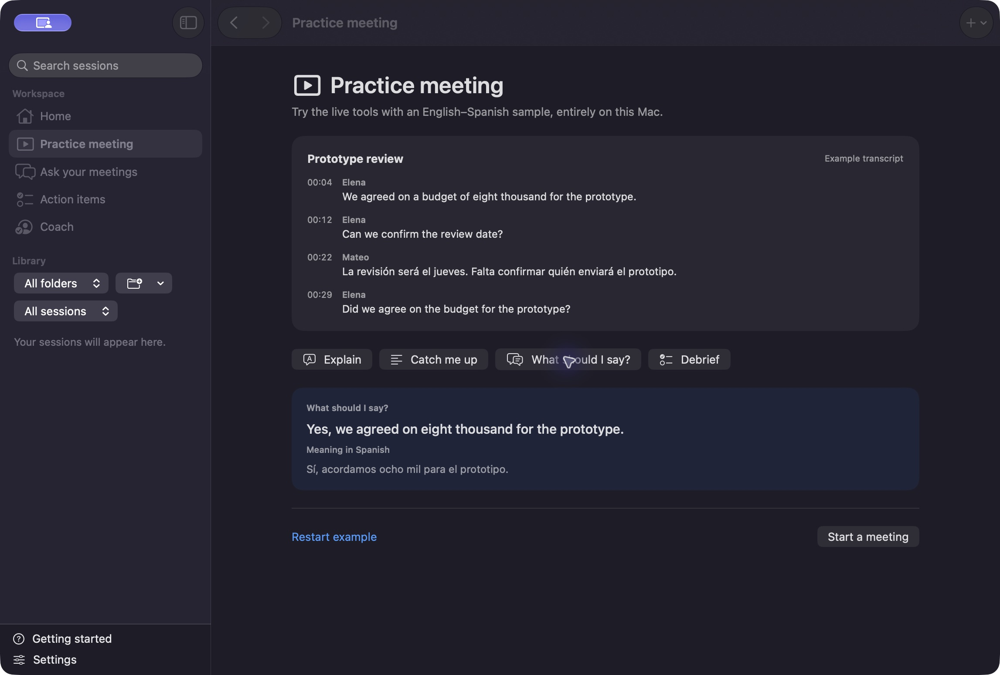
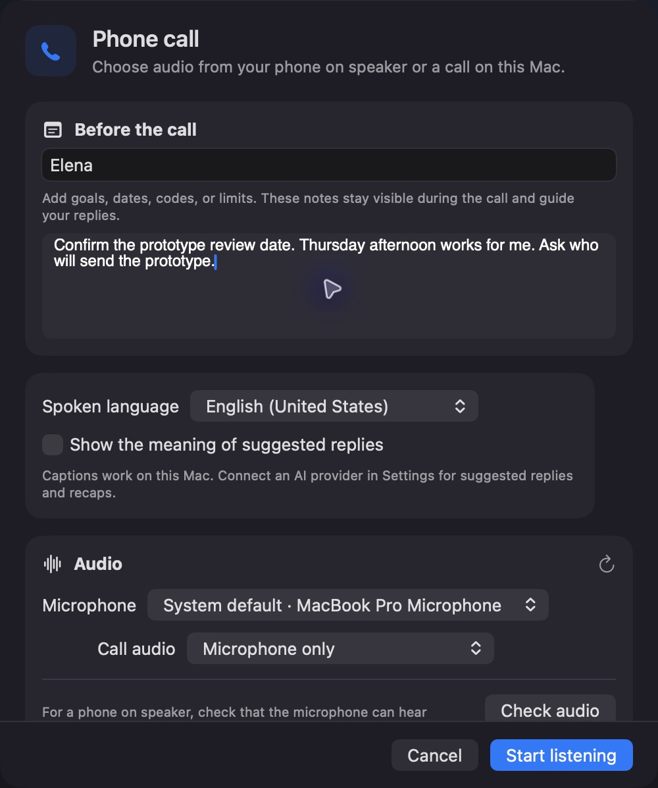

# Voxstead

Live captions, bilingual call assistance, meeting notes, and push-to-talk dictation for macOS. Add your goals before a call, follow what the other person says, and ask for a short reply when you need one. Speech recognition runs on your Mac.

## Install

**Apple Silicon · macOS 26 or later**

```sh
brew install --cask triherm/tap/voxstead
```

Or download the **arm64 DMG** from [GitHub Releases](https://github.com/TriHerm/voxstead/releases/latest) and drag Voxstead into Applications. This release uses an ad hoc signature. If macOS blocks the first launch, review the app under **System Settings → Privacy & Security**. Each release includes a SHA-256 checksum.

## Try it in a minute

Open **Home → Try an example**. Choose **Continue the conversation**, then **What should I say?** to see a short English reply and its Spanish meaning. The built-in example works without a microphone or AI account.



## Choose a workflow

| If you want to… | Start here | What you get |
| --- | --- | --- |
| Find the words in a one-on-one call | **Home → Phone call** | Pinned preparation notes, speaker labels, live captions and short replies on demand with **⌘⌥3**. |
| Follow a meeting and act on decisions | **Home → Start a meeting** | Live captions, Catch me up, a debrief and editable action items. |
| Dictate into another app | Hold **Control–Option–D** | Release to transcribe and copy. Enable cursor insertion in **Settings → Recording**. |

### Set up your first call

1. Under **Before the call**, add facts, goals and limits that should guide replies. Choose the language people will speak.
2. For a phone on speaker, select **Microphone only**. For a call on your Mac, select your microphone plus the calling app. **Check audio** previews the inputs.
3. Choose **Start listening**. With microphone-only capture, mark a line you spoke with **That’s me**. With separate inputs, Voxstead labels your microphone **You** and the app audio **Caller**.
4. Read the captions. Press **⌘⌥3** when you want up to two sentences to say aloud. Use **Simpler** for plainer wording or **Clarify** for a question. Choose **End & recap** to review agreements and next steps.



### Audio and AI

Captions and dictation work on-device. Microphone-only speaker detection downloads its model on first use. Allow microphone access for recording and **Screen & System Audio Recording** for audio from another app.

For AI replies and recaps, connect a provider in **Settings → AI providers**. Asking for a reply shares conversation text and preparation notes with that provider. A recap uses the finished transcript. See the [user guide](docs/user-guide.md) for provider options, caption translation, library backups and keyboard shortcuts.

## Build from source

Install Xcode with Swift 6.2 or later, then run from the repository root:

```sh
./script/build_and_run.sh
```

Run the tests with `xcrun swift test`. See the [build instructions](docs/user-guide.md#run-locally) for packaging and the [MIT license](LICENSE) for reuse.
